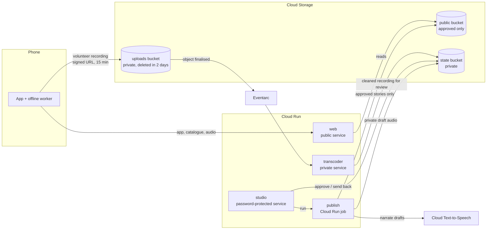

# How Same Moon works

Same Moon is built for a family with a cheap Android phone, a prepaid data bundle and, some nights, no signal at all. And it is built so that nothing reaches a child unless a person has checked it first. Those two constraints shaped every service.

## The services, and why each one exists

**web** (public Cloud Run service, scales to zero), at https://samemoon.world. Serves the app, the catalogue and the audio. The app shell is held in memory and gzipped once; audio files have a content hash in their name, so they are cached for a year and never go stale. It supports byte ranges, because phone audio players ask for them. It holds no secrets and can only read the public bucket. It also hands out a 15-minute signed link when a volunteer sends a recording, so the recording goes straight into a private bucket without passing through the server. The domain (bought at Hostinger on 18 Nov 2026) is a Cloud Run domain mapping on this service, for samemoon.world and www.samemoon.world, with Google-managed certificates; the DNS records (four A, four AAAA, and www as a CNAME to ghs.googlehosted.com) are at Hostinger. Redeploying the service keeps the mapping; renaming or deleting the service breaks it. The original address, https://web-qdzmk3s3cq-ew.a.run.app, still works.

**publish** (Cloud Run job). Does the slow work so the web service never has to:
1. For every story, in every language, it narrates the current text with Cloud Text-to-Speech, page by page, joins the pages with short pauses, evens out the loudness and encodes it for phones: Opus at 18 kbps (about 230 to 300 KB for a three-minute story) with an AAC copy for older iPhones. It records the second each page starts, so the app can highlight the page being read. Draft audio goes to the **private** bucket, so a reviewer can listen before approving.
2. It copies only stories a person has approved, for that exact text, to the **public** bucket, and writes the catalogue.

It runs when a reviewer approves something, and narration is only redone when the words change.

**studio** (Cloud Run service, password in Secret Manager). Where a reviewer reads, listens and approves each story in each language, or sends it back with a note. Approval is tied to a hash of the exact words: edit one word and the story drops out of the app until it is approved again. Volunteer recordings are approved or rejected here too.

**transcoder** (private Cloud Run service, invoked by Eventarc). When a volunteer recording lands in the uploads bucket, Eventarc calls it. It trims silence, removes rumble, evens out the volume, caps the length at ten minutes, encodes it small, and files it for review. Then it deletes the raw upload. Too short or not audio: rejected and deleted.

## Built for safety

- **A person approves everything.** Nothing is in the public bucket unless a reviewer approved that exact text or recording.
- **A word guard.** The build fails if a story contains words such as war, soldier, bomb or border, in English, Arabic or Spanish (including Arabic words with attached prefixes). A person must rewrite the line.
- **The computer voice is labelled.** Families always know when a person is reading.
- **Adults only for recordings**, with explicit consent to share, and a review checklist that includes "no background voices of children".

## Built for privacy

- No accounts, cookies, analytics or third-party scripts. The content security policy allows nothing from other sites.
- The only rate limit (on recording uploads) hashes the address with a salt that lives in memory and changes on every restart. Nothing is logged.
- Raw uploads are deleted after processing, and the bucket deletes anything left after two days.
- Each service runs as its own service account with only the access it needs: the public web service cannot read the private bucket.

## Built for a cheap phone

- First visit: about **50 KB** over the network, including all ten stories' text in all three languages and the pictures. Covers are drawn in code, 1 to 3 KB each.
- After one visit with signal, the library opens with **no signal**. A story that has played once with signal stays on the phone and plays again with no data. The offline worker downloads each story file once, hands the player each piece as it arrives, then keeps the file, so nothing is downloaded twice. "Save for offline" keeps a story without playing it first.
- No framework. One script, one stylesheet.
- Right-to-left layout, Arabic plurals and Eastern Arabic numerals for Arabic.

## Cost

Everything scales to zero. Narrating all 30 story versions (ten stories in three languages) uses roughly 40,000 characters of Text-to-Speech. At launch-day traffic the monthly bill should be a few pounds at most.
